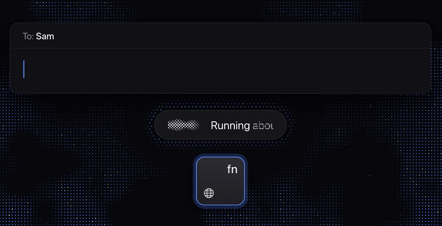
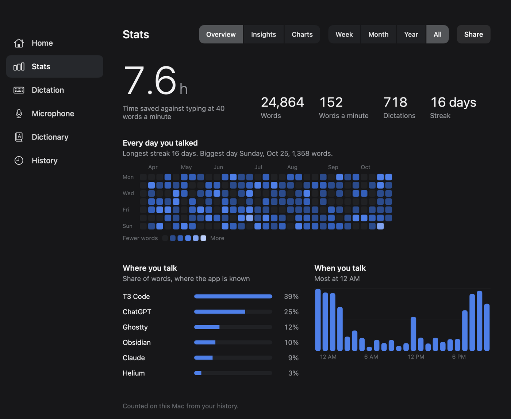

# Lip Service

Lip Service is a free dictation app for the Mac. Hold fn, talk, and let go, and your words appear at the cursor in any app about 0.21 s later. Speech becomes text on your Mac, so your voice never leaves it.

Hold fn and Control instead and say what you want written, and the AI agent you already use writes it in your voice. Hold fn and Option to hand a task to that agent in its own app.

Download it at [uselipservice.com](https://uselipservice.com), or [install it with your AI agent](#install-with-an-ai-agent).

## Requirements

- A Mac with Apple silicon. The app is built for arm64 only, so it does not run on Intel Macs.
- macOS 26 or later.
- About 460 MB of disk space for the speech model, about 240 MB more for smart formatting, and about 100 MB more once you add a word to the dictionary.
- English. The speech model understands English only.
- For Ghostwrite and Hand off only: an agent that speaks the Agent Client Protocol, such as Claude Code, Codex, Hermes, or OpenCode. Dictation needs none.

## Install with an AI agent

Paste this into Claude Code, Codex, or another coding agent that can run commands on your Mac. It installs the latest release, but only after it checks that the app is signed with the author's certificate. Read each command before you approve it.

	Install Lip Service on this Mac. It's a free, open source dictation app:
	https://github.com/hunterbohm/lip-service

	Run these steps in Terminal. Tell me what each one does, and stop if a check
	fails.

	1. Check that this Mac has Apple silicon (`uname -m` prints arm64) and
	   macOS 26 or later (`sw_vers -productVersion`).
	2. Make a temporary folder. Find the .zip in the latest release with
	   `curl -s https://api.github.com/repos/hunterbohm/lip-service/releases/latest`,
	   download it with `curl -L`, and unzip it with `ditto -x -k`.
	3. Check that the app is the real one.
	   `codesign --verify --deep --strict "Lip Service.app"` must pass. Then run
	   `codesign -d --extract-certificates=cert "Lip Service.app"` and
	   `shasum -a 256 cert0`. The hash must be
	   760d91571175800b1e66274c20aad991ce484d1fac366eab7c14d58a8e9feb0b.
	4. If Lip Service is running, quit it. Move the app into /Applications,
	   replacing any older copy. If there is also a copy in ~/Applications,
	   move that one to the Trash, so only one copy is left.
	5. The app is signed by its author but not notarized by Apple, so macOS
	   would block it. Clear the download flag with
	   `xattr -dr com.apple.quarantine "/Applications/Lip Service.app"`, open the
	   app, and delete the temporary folder.
	6. Tell me to finish the setup on the Home page of the Lip Service window:
	   allow the microphone, turn on Lip Service under Accessibility, and set
	   Keyboard > "Press fn key to" (or "Press 🌐 key to") to Do Nothing. Then
	   tell me to wait while the bar downloads the speech model, about 460 MB,
	   and how to use it: hold fn, talk, and let go.

The same prompt updates Lip Service to the latest release.

## Download

Download `Lip-Service-1.0.23.zip` from the [latest release](https://github.com/hunterbohm/lip-service/releases/latest).

## Install

1. Open the zip. Drag **Lip Service** into your **Applications** folder.

	To check that this copy is the author's before you allow it, run these two commands in Terminal. The first must pass, and the second must print 760d91571175800b1e66274c20aad991ce484d1fac366eab7c14d58a8e9feb0b.

		codesign --verify --deep --strict "/Applications/Lip Service.app"
		codesign -d --extract-certificates=/tmp/lip-service-cert "/Applications/Lip Service.app" && shasum -a 256 /tmp/lip-service-cert0

2. Open Lip Service. macOS blocks it, because the app is signed with its author's own certificate and is not notarized by Apple. Close the message, and don't move the app to the Trash.
3. Open System Settings > **Privacy & Security**. Scroll down to **Security**, click **Open Anyway** next to the message about Lip Service, and confirm when macOS asks.

	To do steps 2 and 3 in Terminal instead, run this command, then open the app:

		xattr -dr com.apple.quarantine "/Applications/Lip Service.app"

4. When Lip Service asks for the microphone, click **Allow**.
5. When it asks for Accessibility, open System Settings > **Privacy & Security** > **Accessibility** and turn on Lip Service. The app needs Accessibility to see the dictation key and to paste. It notices the change within 2 s, so you don't need to reopen it.
6. Open System Settings > **Keyboard** and set **Press fn key to** to **Do Nothing**. On a keyboard with a globe key, the setting is called **Press 🌐 key to**. If you skip this, macOS also acts on fn.
7. Wait while the bar at the bottom of the screen downloads the speech model, about 460 MB, and prepares it for your Mac. Preparing takes about a minute. Later launches load the model in about a second.

On the first launch, a setup window walks you through steps 4 to 6, a first dictation, your styles, and, if you want, your agent. Afterwards the Home page shows any of steps 4 to 6 that still needs doing, with a button that opens the right System Settings pane.

From 1.0.8, Lip Service says in its menu bar menu and on the Home page when a newer release is out. To update, quit Lip Service and replace the app in **Applications** with the new one. macOS blocks the new copy once, so allow it again as in step 3. The Microphone permission stays, because every release is signed with the same certificate. If fn does nothing after an update, turn Lip Service off and back on in System Settings > **Privacy & Security** > **Accessibility**.

## Use it

- Hold fn or Right Control, speak, and let go. The text is pasted at the cursor.
- To dictate without holding the key, tap it twice. Press it once more to insert the text, or press Escape to throw it away.
- To paste your last dictation again, press Control+Command+V.
- While you speak, a bar at the bottom of the screen shows soft blue waves that follow your voice: each sound swells in the middle and ripples out to both ends, and the waves run faster and brighter as you speak up. A soft blue rim around it glows brighter as you talk while a beam of light runs around its edge. Drag it to the top or to either side of the screen.
- Lip Service removes filler words such as "um" and fixes capitals and punctuation.
- **Smart formatting** adds paragraphs, numbered and bulleted lists, and quotation marks where they fit, without you saying "new paragraph" or "quote". Say "first… second… third…" and you get a numbered list. A model on your Mac reads what you said, your pauses, and the kind of app the text goes into. It only adds breaks, list markers and quotes, fixes punctuation, and drops counting words such as "first", so every other word goes in as you said it. To turn it off, clear **Smart formatting** on the **Dictation** page.
- To teach it a name it gets wrong, open the **Dictionary** page and click **Add Word**. If the name still comes out wrong, add the ways it gets misheard, too.
- When you correct one word it typed, Lip Service adds your spelling to the dictionary and says so on the bar, with **Undo**.
- Names shown in the window you're dictating into, such as the people in a chat, come out spelled the way the screen shows them. Lip Service reads them on your Mac when you start talking and keeps nothing.
- On the **Profiles** page, pick a style for each group of apps: **Formal**, **Casual** with no period at the end, or **Very casual** in lowercase. Each group can also press Return for you after the text goes in, only into the field you dictated into.
- **Ghostwrite**: hold fn and Control, say what you want written, such as "reply that Thursday works, after 3", and let go. Your agent reads the window you're in and writes it in your voice. The draft streams into a card: press Return to type it, hold the keys again and say a change, or press Escape to throw it away.
- **Hand off**: hold fn and Option and say a task. After a 5 s countdown that Escape cancels, it goes to your agent in its own app: Hermes in iMessage, Claude Code or Codex as a new T3 Code thread, or Telegram, Slack, Discord, a web address, or a command.
- **Live talk**: double-tap Left Control and talk with your agent out loud, hands free. Pause and it answers in a voice made on your Mac; talk over it to cut in. It works with any agent Lip Service can reach. A black island like the iPhone's Dynamic Island shows the talk at the top of the screen, growing out of the notch on a MacBook that has one, or floating just below another app's top bar, such as a tiling window manager's: a colored orb that swells with the voice, and the agent's words as it says them. Links, images, code and charts the agent wants you to see show up as cards under it instead of being read out. Double-tap again, say "goodbye", or hover over the island and click its x to end. Two minutes of quiet ends it too.
- **Call back**: give your agent a long task in a talk and hang up. When it's done, the agent's script runs `Dictation call` and the island rings; double-tap Left Control to answer and the agent says the result. It won't ring while the screen is locked, a Focus is on, or another app has the microphone or camera, as in a meeting, and tells the agent so it can text you instead. See the reference.
- The setup window on first launch walks you through permissions, a first dictation, your styles, and your agent. To have your agent do it instead, click **Let my agent set it up**, or **Copy setup prompt** on the Ghostwrite page, and paste the prompt into your agent. Lip Service lists what it changed, with **Undo**.
- To insert text you type often, such as your address, add a snippet on the **Dictionary** page. Say its cue on its own and the saved text goes in exactly as written.
- To stop music and videos playing over you, turn on **Mute other audio** on the **Dictation** page. The sound comes back as soon as you stop talking, and again later if an output was unplugged while muted.
- To open the Lip Service window, open the app again from Spotlight or the Finder, or choose **Open Lip Service…** from its menu bar icon. The window has your dictation history and the settings for the keys, the microphone, and the bar.
- The **Stats** page shows how many words you dictated, how fast you talk, and the time you saved compared with typing. **Share** makes an image of your totals.
- If you used Willow Voice, click **Import from Willow** on the Home page to bring over its history and settings.

The [reference](docs/reference.md) describes every feature and setting.

## Uninstall

1. Quit Lip Service from its menu bar icon, and move it from **Applications** to the Trash.
2. To delete your history, dictionary, and settings, delete `~/Library/Application Support/Dictation` and run `defaults delete com.hunterbohm.dictation`.
3. To delete the speech models, delete `~/Library/Application Support/FluidAudio`. Other apps built on FluidAudio keep their models there too.
4. Remove Lip Service from System Settings > **Privacy & Security** > **Microphone** and **Accessibility**.

## Privacy

- Speech becomes text on your Mac, with models that run on its chip. The audio stays in memory and is never written to disk or sent anywhere.
- Lip Service goes online by itself for four things, each described below: the speech models, the formatting model, the usage count, and the update check. Ghostwrite and Hand off send only to the agent and apps you set up. It has no account.
- **Speech models.** On first launch it downloads its speech models from huggingface.co, at fixed versions and with no account token. It fetches only the files the app expects, refuses to write anywhere outside its model folder, and checks every file against a SHA-256 hash built into the app before it uses it.
- **Formatting model.** With **Smart formatting** on, Lip Service downloads its formatting model once, about 110 MB, from this repository's GitHub releases, at a fixed version, with no cookies and no account. It checks the archive against a SHA-256 hash built into the app, and every file in it, before it uses it. The model runs on your Mac. It was trained only on made-up dictations, none of them real.
- **Usage count.** Once a day, the first time you finish a dictation, a Ghostwrite or a Hand off, Lip Service sends one small report to a Cloudflare Worker that its author runs, so the author can see how many people use it. The report holds exactly five things: a SHA-256 hash of a random ID made on your Mac (the ID itself never leaves it), the Lip Service version, the macOS version, the UTC date, and which of dictation, Ghostwrite and Hand off you used first that day. It never holds your voice, your words, the names of your apps or windows, what is on your screen, or which agent you use. The server stores those five things and nothing else, with no IP address. It ignores a report it can't read and a second one for the same day. To turn it off, clear **Send an anonymous daily usage count** on the **Dictation** page, and nothing is sent. The code for the report is in `DictationCore/Sources/DictationCore/UsageCount.swift` and the server is in `usage-worker/`.
- **Update check.** Once a day, Lip Service asks GitHub which release is newest and tells you in the menu bar menu and on the Home page when yours is older. The request carries no ID and no cookies, and the app installs nothing by itself. To turn it off, clear **Check for updates** on the **Dictation** page, and nothing is sent.
- Your dictations are saved on your Mac in `~/Library/Application Support/Dictation/history.jsonl`, so the Home page can list them. Each one also notes the app you dictated into. To stop saving them, turn off **Keep history** on the History page. **Delete All History** removes the file. The Stats page is counted from this file on your Mac, and its share image holds totals and a calendar, never your words or the apps.
- Ghostwrite, Hand off and Live talk send what you said, as text, to the agent you set up. Your audio is never sent.
- **Live talk voice.** The first talk downloads the Phonon voice pack, 134 MB, from huggingface.co, with no account token. Like the speech models, it is pinned to a commit and every file is checked against hashes built into the app before it is used. If you pick a Kokoro voice instead, Kokoro's files, about 90 MB, are downloaded the same way but are not pinned or checked. The voice is made on your Mac. If you pick a voice server instead, the agent's replies go to that server as text to be spoken. During a talk the agent may read, search and think without asking. Anything else it asks for, Lip Service asks you: a spoken "no" refuses, but running a command, editing, deleting or moving needs **Allow** clicked on the card, so a misheard word can't approve it. The one other thing a spoken "yes" allows is starting a T3 Code thread, when you talk with Claude Code and T3 Code is connected: Lip Service asks "Start a T3 Code thread in the project, called such and such", and that, built from what Claude Code passes to T3 Code, is all a yes covers. A Ghostwrite request also carries what Lip Service can read of the window you're in: its title, the field around the cursor, and nearby text. With **Learn my voice from my dictations** on, it also carries up to 8 of your recent dictations from the same kind of app, as examples of how you write. Password apps and password fields are never read.
- A draft needs no tools, and the window's text can come from someone else, such as an email with instructions hidden in it. So Claude Code drafts start with its tools off and Codex drafts run read-only with no network. With any agent, Lip Service refuses every permission request during a draft and stops the draft as soon as the agent starts a tool. An agent that runs tools without asking may already have started one by then, so pick one whose own permission rules you trust.
- A hand-off carries the window's text, up to 4,000 characters, only while **Send the window's text with hand-offs** is on. New installs start with it off.
- **Build with** on the Ghostwrite page sends up to 30 of your recent dictations to your agent once, so it can write notes on how you write. While it does, it may only read, search, and think.
- The agent runs under its own permission rules and may pass what it gets to its AI provider. Slack and Discord tokens, a web address's signing secret, and the T3 Code sign-in stay in your Mac's Keychain. A web address itself is saved with your settings, so put no secret in it, and use the signing secret instead.
- To paste, Lip Service puts the text on the clipboard and presses Command+V for you. Then it puts back what the clipboard held before.
- To spot your dictation keys, Lip Service sees every key you press, through Accessibility. It does not record, store, or send them.
- With **Smart spacing** on, it reads the text just before the cursor to decide on a space and a capital letter. It does not keep that text.

## How well it works

The test clips are 15 chat messages, emails, notes, and prompts for AI agents, read aloud by the macOS voice Samantha. They hold 20 uses of 13 names that speech models often get wrong, such as Beehiiv, Tailscale, and ProfitPilot. All timing ran on a Mac mini with an M4 chip.

| | Word error rate | Names spelled right | Text after you let go, median |
| --- | --- | --- | --- |
| Lip Service 1.0.6 | 0.3% | 20 of 20 | 0.15 s |
| Apple DictationTranscriber, with the names as a word list | 2.7% | 19 of 20 | 0.10 s |
| Apple SpeechTranscriber, with the names as a word list | 5.6% | 11 of 20 | 0.21 s |
| Parakeet with no name boosting | 4.3% | 12 of 20 | 0.16 s |
| Whisper large-v3-turbo, through whisper.cpp | 3.2% | 13 of 20 | 1.24 s |

Every row is 5 rounds of the 15 clips. The Lip Service row comes from `ROUNDS=5 scripts/e2e.sh`, which runs the built app on each clip. 1.0.6 changed how names are matched, and that work was tuned while looking at these clips, so expect more misses on speech it has not seen. The other rows come from the bakeoff that picked the speech engine, in [bench/bakeoff-2026-10-25.txt](bench/bakeoff-2026-10-25.txt), where the two Apple engines are `dt-vocab` and `sa-vocab`, Parakeet is `pk`, and Whisper is `wh`. Lip Service spells the 13 names right because the test puts them in its dictionary. Your own names need to go in your dictionary in the same way.

### Smart formatting

The test is 400 of the author's own dictations that the formatting model never saw, run through the app, with Willow's formatting of the same recordings as the answer key. Of the 322 that Willow left without paragraphs, lists or quotes, Lip Service left 98% alone too. It found 9 of Willow's 11 list items and 11 of its 37 quotes, and 69% of the quotes it added are in Willow's text as well. Where to break a paragraph is partly taste, so those scores stay low for any formatter: Claude Sonnet, asked to format the same text, put 60% of its breaks where Willow did. The formatting step took a median 5.5 ms per dictation on a MacBook Pro with an M4 Pro, on top of the times below.

### Against Willow and Wispr Flow

| | Text after you let go, median | Slowest 5% | Word error rate | Names spelled right |
| --- | --- | --- | --- | --- |
| Lip Service 1.0.0 | 0.21 s | 0.30 s | 0.8% | 19 of 20 |
| Willow 2.6.9, Pro plan | 0.37 s | 0.53 s | 1.9% | 19 of 20 |
| Wispr Flow 1.6.1264, Free plan | 0.39 s | 0.64 s | 1.7% | 20 of 20 |

This test drives each app the way a person does. [RivalBench](bench/rivals) holds the app's key, plays each clip into a virtual microphone, lets go, and times the text landing in a text box. That time includes the paste, which the table above leaves out. Every row is 5 rounds of the 15 clips, with all three apps running at once on the same Mac mini. Most of the rivals' errors are formatting, such as turning a spoken list into a numbered one, so the accuracy columns are close to a tie. The setup and the raw results are in [bench/rivals/results/2026-10-27](bench/rivals/results/2026-10-27).

## Build from source

You need a Mac with Apple silicon, macOS 26, and the Command Line Tools with Swift 6.2 or later. Xcode is not needed.

	git clone https://github.com/hunterbohm/lip-service.git
	cd lip-service
	scripts/fetch-deps.sh
	scripts/test.sh
	scripts/build-app.sh

`fetch-deps.sh` downloads FluidAudio v0.18.3 into `Vendor/FluidAudio` and patches it. `build-app.sh` builds `dist/Lip Service.app` and signs it with a self-signed certificate. It makes the certificate on the first run and keeps it in `~/.config/dictation/signing`. The [reference](docs/reference.md) covers the end-to-end test, the headless test modes, and signing.

## Credits

- [FluidAudio](https://github.com/FluidInference/FluidAudio) v0.18.3, by FluidInference, runs the speech models. It is licensed under Apache 2.0. `scripts/fetch-deps.sh` applies six patches to it. One removes the NemoTextProcessing binary target, which the app does not use. One makes vocabulary rescoring faster without changing its output. One lets the app give the rescorer a tokenizer it already loaded, so the tokenizer file is read once. One keeps a word the speech model was sure of when a dictionary term spelled a little differently would replace it. One also compares by sound, so a spelling of the same sounds counts as a near match. The last makes the model download fetch only the files the app expects.
- [Parakeet TDT 0.6B v2](https://huggingface.co/nvidia/parakeet-tdt-0.6b-v2), by NVIDIA, turns speech into text. Lip Service uses FluidInference's [Core ML conversion](https://huggingface.co/FluidInference/parakeet-tdt-0.6b-v2-coreml). Both are licensed under CC BY 4.0.
- [parakeet-ctc-110m](https://huggingface.co/FluidInference/parakeet-ctc-110m-coreml), FluidInference's Core ML conversion of NVIDIA's [Parakeet TDT-CTC 110M](https://huggingface.co/nvidia/parakeet-tdt_ctc-110m), boosts the words in your dictionary. Both are licensed under CC BY 4.0.

The app downloads the models from Hugging Face on first use and does not include them. The license texts for the code compiled into the app are in `Lip Service.app/Contents/Resources/Licenses`.

## License

Lip Service is released under the [MIT license](LICENSE).
