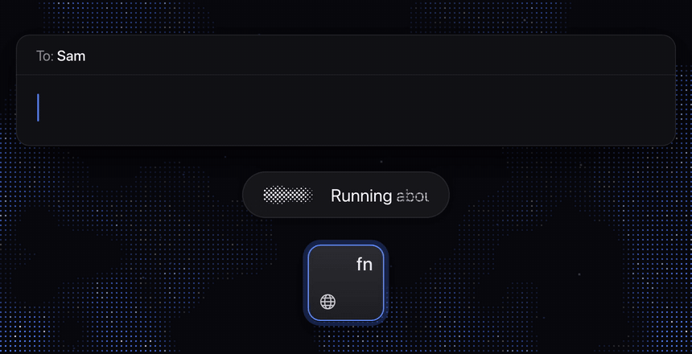
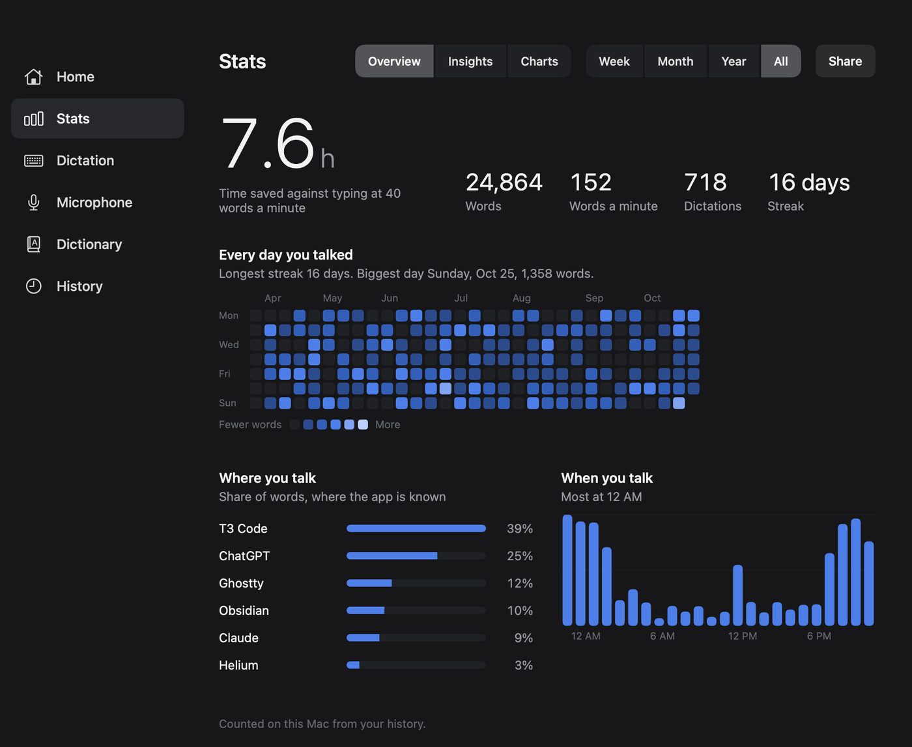

# Lip Service

Lip Service is a free dictation app for the Mac. Hold fn, talk, and let go, and your words appear at the cursor in any app about 0.21 s later. Speech becomes text on your Mac, so your voice never leaves it.

## Requirements

- A Mac with Apple silicon. The app is built for arm64 only, so it does not run on Intel Macs.
- macOS 26 or later.
- About 460 MB of disk space for the speech model, and about 100 MB more once you add a word to the dictionary.
- English. The speech model understands English only.

## Install with an AI agent

Paste this into Claude Code, Codex, or another coding agent that can run commands on your Mac. It installs the latest release, but only after it checks that the app is signed with the author's certificate. Read each command before you approve it.

	Install Lip Service on this Mac. It's a free, open source dictation app:
	https://github.com/hunterbohm/lip-service

	Run these steps in Terminal. Tell me what each one does, and stop if a check
	fails.

	1. Check that this Mac has Apple silicon (`uname -m` prints arm64) and
	   macOS 26 or later (`sw_vers -productVersion`).
	2. Make a temporary folder. Find the .zip in the latest release with
	   `curl -s https://api.github.com/repos/hunterbohm/lip-service/releases/latest`,
	   download it with `curl -L`, and unzip it with `ditto -x -k`.
	3. Check that the app is the real one.
	   `codesign --verify --deep --strict "Lip Service.app"` must pass. Then run
	   `codesign -d --extract-certificates=cert "Lip Service.app"` and
	   `shasum -a 256 cert0`. The hash must be
	   760d91571175800b1e66274c20aad991ce484d1fac366eab7c14d58a8e9feb0b.
	4. If Lip Service is running, quit it. Move the app into /Applications,
	   replacing any older copy. If there is also a copy in ~/Applications,
	   move that one to the Trash, so only one copy is left.
	5. The app is signed by its author but not notarized by Apple, so macOS
	   would block it. Clear the download flag with
	   `xattr -dr com.apple.quarantine "/Applications/Lip Service.app"`, open the
	   app, and delete the temporary folder.
	6. Tell me to finish the setup on the Home page of the Lip Service window:
	   allow the microphone, turn on Lip Service under Accessibility, and set
	   Keyboard > "Press fn key to" (or "Press 🌐 key to") to Do Nothing. Then
	   tell me to wait while the bar downloads the speech model, about 460 MB,
	   and how to use it: hold fn, talk, and let go.

The same prompt updates Lip Service to the latest release.

## Download

Download `Lip-Service-1.0.5.zip` from the [latest release](https://github.com/hunterbohm/lip-service/releases/latest).

## Install

1. Open the zip. Drag **Lip Service** into your **Applications** folder.
2. Open Lip Service. macOS blocks it, because the app is signed with its author's own certificate and is not notarized by Apple. Close the message, and don't move the app to the Trash.
3. Open System Settings > **Privacy & Security**. Scroll down to **Security**, click **Open Anyway** next to the message about Lip Service, and confirm when macOS asks.

	To do steps 2 and 3 in Terminal instead, run this command, then open the app:

		xattr -dr com.apple.quarantine "/Applications/Lip Service.app"

4. When Lip Service asks for the microphone, click **Allow**.
5. When it asks for Accessibility, open System Settings > **Privacy & Security** > **Accessibility** and turn on Lip Service. The app needs Accessibility to see the dictation key and to paste. It notices the change within 2 s, so you don't need to reopen it.
6. Open System Settings > **Keyboard** and set **Press fn key to** to **Do Nothing**. On a keyboard with a globe key, the setting is called **Press 🌐 key to**. If you skip this, macOS also acts on fn.
7. Wait while the bar at the bottom of the screen downloads the speech model, about 460 MB, and prepares it for your Mac. Preparing takes about a minute. Later launches load the model in about a second.

The Lip Service window opens on the first launch. Its Home page shows each of steps 4 to 6 that still needs doing, with a button that opens the right System Settings pane.

To update, quit Lip Service and replace the app in **Applications** with the new one. macOS blocks the new copy once, so allow it again as in step 3. The Microphone and Accessibility permissions stay, because every release is signed with the same certificate.

## Use it

- Hold fn or Right Control, speak, and let go. The text is pasted at the cursor.
- To dictate without holding the key, tap it twice. Press it once more to insert the text, or press Escape to throw it away.
- To paste your last dictation again, press Control+Command+V.
- While you speak, a bar at the bottom of the screen shows a halftone print of your voice and the words heard so far. Drag it to the top or to either side of the screen.
- Lip Service removes filler words such as "um" and fixes capitals and punctuation.
- To teach it a name it gets wrong, open the **Dictionary** page and click **Add Word**. If the name still comes out wrong, add the ways it gets misheard, too.
- To open the Lip Service window, open the app again from Spotlight or the Finder, or choose **Open Lip Service…** from its menu bar icon. The window has your dictation history and the settings for the keys, the microphone, and the bar.
- The **Stats** page shows how many words you dictated, how fast you talk, and the time you saved compared with typing. **Share** makes an image of your totals.
- If you used Willow Voice, click **Import from Willow** on the Home page to bring over its history and settings.

The [reference](docs/reference.md) describes every feature and setting.

## Uninstall

1. Quit Lip Service from its menu bar icon, and move it from **Applications** to the Trash.
2. To delete your history, dictionary, and settings, delete `~/Library/Application Support/Dictation` and run `defaults delete com.hunterbohm.dictation`.
3. To delete the speech models, delete `~/Library/Application Support/FluidAudio`. Other apps built on FluidAudio keep their models there too.
4. Remove Lip Service from System Settings > **Privacy & Security** > **Microphone** and **Accessibility**.

## Privacy

- Speech becomes text on your Mac, with models that run on its chip. The audio stays in memory and is never written to disk or sent anywhere.
- Lip Service goes online only to download its models from Hugging Face. It downloads a fixed version of each, and it checks every file against a SHA-256 hash built into the app before it uses it. It has no account and no analytics.
- Your dictations are saved on your Mac in `~/Library/Application Support/Dictation/history.jsonl`, so the Home page can list them. Each one also notes the app you dictated into. To stop saving them, turn off **Keep history** on the History page. **Delete All History** removes the file. The Stats page is counted from this file on your Mac, and its share image holds totals and a calendar, never your words or the apps.
- To paste, Lip Service puts the text on the clipboard and presses Command+V for you. Then it puts back what the clipboard held before.
- To spot your dictation keys, Lip Service sees every key you press, through Accessibility. It does not record, store, or send them.
- With **Smart spacing** on, it reads the text just before the cursor to decide on a space and a capital letter. It does not keep that text.

## How well it works

The test clips are 15 chat messages, emails, notes, and prompts for AI agents, read aloud by the macOS voice Samantha. They hold 20 uses of 13 names that speech models often get wrong, such as Beehiiv, Tailscale, and ProfitPilot. All timing ran on a Mac mini with an M4 chip.

| | Word error rate | Names spelled right | Text after you let go, median |
| --- | --- | --- | --- |
| Lip Service 1.0.0 | 0.8% | 20 of 20 | 0.16 s |
| Apple DictationTranscriber, with the names as a word list | 2.7% | 19 of 20 | 0.10 s |
| Apple SpeechTranscriber, with the names as a word list | 5.6% | 11 of 20 | 0.21 s |
| Parakeet with no name boosting | 4.3% | 12 of 20 | 0.16 s |
| Whisper large-v3-turbo, through whisper.cpp | 3.2% | 13 of 20 | 1.24 s |

Every row is 5 rounds of the 15 clips. The Lip Service row comes from `scripts/e2e.sh`, which runs the built app on each clip. The other rows come from the bakeoff that picked the speech engine, in [bench/bakeoff-2026-10-25.txt](bench/bakeoff-2026-10-25.txt), where the two Apple engines are `dt-vocab` and `sa-vocab`, Parakeet is `pk`, and Whisper is `wh`. Lip Service spells the 13 names right because the test puts them in its dictionary. Your own names need to go in your dictionary in the same way.

### Against Willow and Wispr Flow

| | Text after you let go, median | Slowest 5% | Word error rate | Names spelled right |
| --- | --- | --- | --- | --- |
| Lip Service 1.0.0 | 0.21 s | 0.30 s | 1.3% | 19 of 20 |
| Willow 2.6.9, Pro plan | 0.37 s | 0.53 s | 2.4% | 19 of 20 |
| Wispr Flow 1.6.1264, Free plan | 0.39 s | 0.64 s | 2.2% | 20 of 20 |

This test drives each app the way a person does. [RivalBench](bench/rivals) holds the app's key, plays each clip into a virtual microphone, lets go, and times the text landing in a text box. That time includes the paste, which is why Lip Service shows 0.21 s here and 0.16 s in the table above. Every row is 5 rounds of the 15 clips, with all three apps running at once on the same Mac mini. Most of the rivals' errors are formatting, such as turning a spoken list into a numbered one, so the accuracy columns are close to a tie. The setup and the raw results are in [bench/rivals/results/2026-10-27](bench/rivals/results/2026-10-27).

## Build from source

You need a Mac with Apple silicon, macOS 26, and the Command Line Tools with Swift 6.2 or later. Xcode is not needed.

	git clone https://github.com/hunterbohm/lip-service.git
	cd lip-service
	scripts/fetch-deps.sh
	scripts/test.sh
	scripts/build-app.sh

`fetch-deps.sh` downloads FluidAudio v0.17.7 into `Vendor/FluidAudio` and patches it. `build-app.sh` builds `dist/Lip Service.app` and signs it with a self-signed certificate. It makes the certificate on the first run and keeps it in `~/.config/dictation/signing`. The [reference](docs/reference.md) covers the end-to-end test, the headless test modes, and signing.

## Credits

- [FluidAudio](https://github.com/FluidInference/FluidAudio) v0.17.7, by FluidInference, runs the speech models. It is licensed under Apache 2.0. `scripts/fetch-deps.sh` applies three patches to it. One removes the NemoTextProcessing binary target, which the app does not use. One makes vocabulary rescoring faster without changing its output. The third lets the app give the rescorer a tokenizer it already loaded, so the tokenizer file is read once.
- [Parakeet TDT 0.6B v2](https://huggingface.co/nvidia/parakeet-tdt-0.6b-v2), by NVIDIA, turns speech into text. Lip Service uses FluidInference's [Core ML conversion](https://huggingface.co/FluidInference/parakeet-tdt-0.6b-v2-coreml). Both are licensed under CC BY 4.0.
- [parakeet-ctc-110m](https://huggingface.co/FluidInference/parakeet-ctc-110m-coreml), FluidInference's Core ML conversion of NVIDIA's [Parakeet TDT-CTC 110M](https://huggingface.co/nvidia/parakeet-tdt_ctc-110m), boosts the words in your dictionary. Both are licensed under CC BY 4.0.

The app downloads the models from Hugging Face on first use and does not include them. The license texts for the code compiled into the app are in `Lip Service.app/Contents/Resources/Licenses`.

## License

Lip Service is released under the [MIT license](LICENSE).
